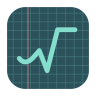
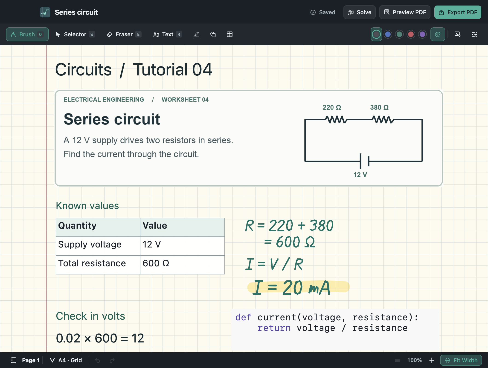
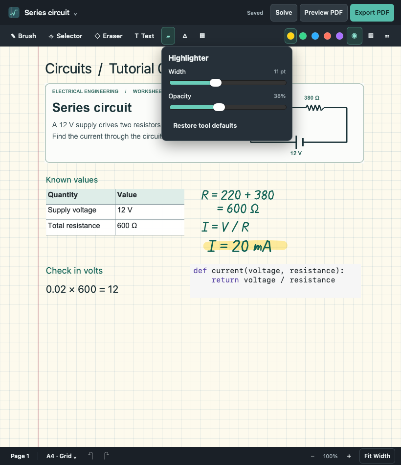

<p align="center"></p>

# Gridnote

Paste an exercise, solve it by hand, and share the finished A4 pages. Gridnote saves locally and reopens at the same place.



## Get started

| Device | Open Gridnote |
| --- | --- |
| Mac with a pen tablet | Open the macOS app. The launcher displays the tablet name when the system provides it. |
| Windows or Linux | Extract the standalone ZIP for your processor and run Gridnote. The executable opens its embedded editor in your default browser. |
| iPad, Android, phone or Chromebook | Open an HTTPS-hosted portable build. On iPad, use Safari’s **Share → Add to Home Screen**. Allow the first visit to finish caching the app for offline use. |

Choose **New Notebook** or open an existing notebook or PDF. Try the [editable circuit exercise](docs/examples/Series%20circuit.gridnote) or see its [finished PDF](docs/examples/Series%20circuit.pdf).

## In a lecture

- Write with **Q**, select with **W**, erase with **E**, and type with **R**. Tap a tool for options. Brush includes Pen, Brush and Fineliner, smoothing and optional pressure response.
- On a two-button pen, tap the upper switch, erase, then lift to return to Brush. Hold the lower switch and move vertically to scroll.
- Paste a screenshot or use **Add image**. Touch devices can capture and crop a rear-camera photo. Use the selector to move, align or resize objects.
- Tap the page control for thumbnails. Insert, move or delete pages with their PDF backgrounds and annotations. **Remove Typed Text** can clean one page or all pages and preserves filled tables and other objects.
- Choose **Solve**, then tap a highlighted problem. Review the recognized text beside the scan. Arithmetic, real linear and quadratic equations, common unit conversions and simple code fragments work offline. Open-ended questions can use the optional tutor.
- In writing settings, **Major** defaults to **None**. Choose a subject to show its study tools. Chemistry has a periodic table and molar-mass calculator. Computer Science has exact base conversion and two’s complement. Physics, Mathematics, Medicine, Electrical Engineering and Mechanical Engineering have focused tools. Results can be inserted into the notebook.
- **Preview PDF → Share** opens the system share sheet on supported devices. **Export PDF** saves the same A4 document.



## Storage and optional AI

The Mac app writes editable notebooks and recovery copies locally. The portable app saves in the current browser’s local library. Download a `.gridnote` file from the notebook menu to back it up or move it to another device.

Image recognition runs on the device. **Ask AI** sends the selected exercise text and displayed crop to a configured local study server. The server uses the OpenAI Responses API with your key and API billing. A static hosted build supports the **Copy to ChatGPT** handoff.

## Build

On macOS with the Command Line Tools, run `./build.sh` and open `build/Gridnote.app`. The build targets macOS 13 or newer and uses an ad hoc signature.

For the offline portable app, run the following from the source directory.

```sh
python3 scripts/prepare_web.py build/standalone
python3 study_server.py
```

Open [the local notebook](http://127.0.0.1:8765). Set `OPENAI_API_KEY` in the server environment to enable Ask AI. To host the installable app, serve `build/standalone` over HTTPS. To build a Windows or Linux executable with Go, use `python3 scripts/desktop.py build/standalone build/releases --os windows --arch amd64`. The launcher serves embedded assets on loopback.

The project includes an [offline user guide](web/guide.html), [design sources and verification notes](docs/implementation.md), and an [MIT license](LICENSE). Bundled dependencies retain their own licenses.
