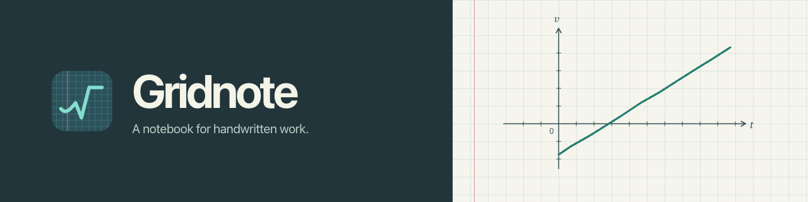
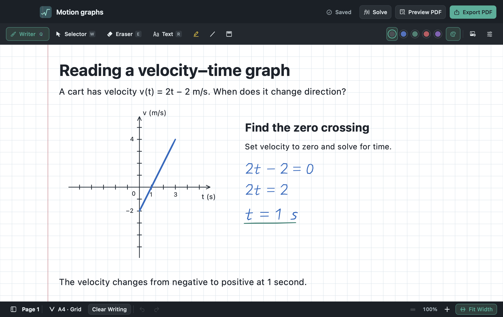
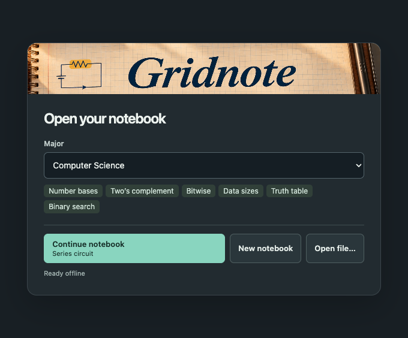
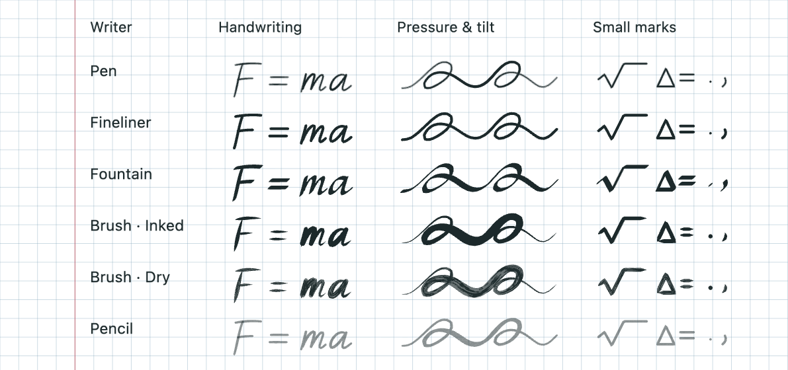
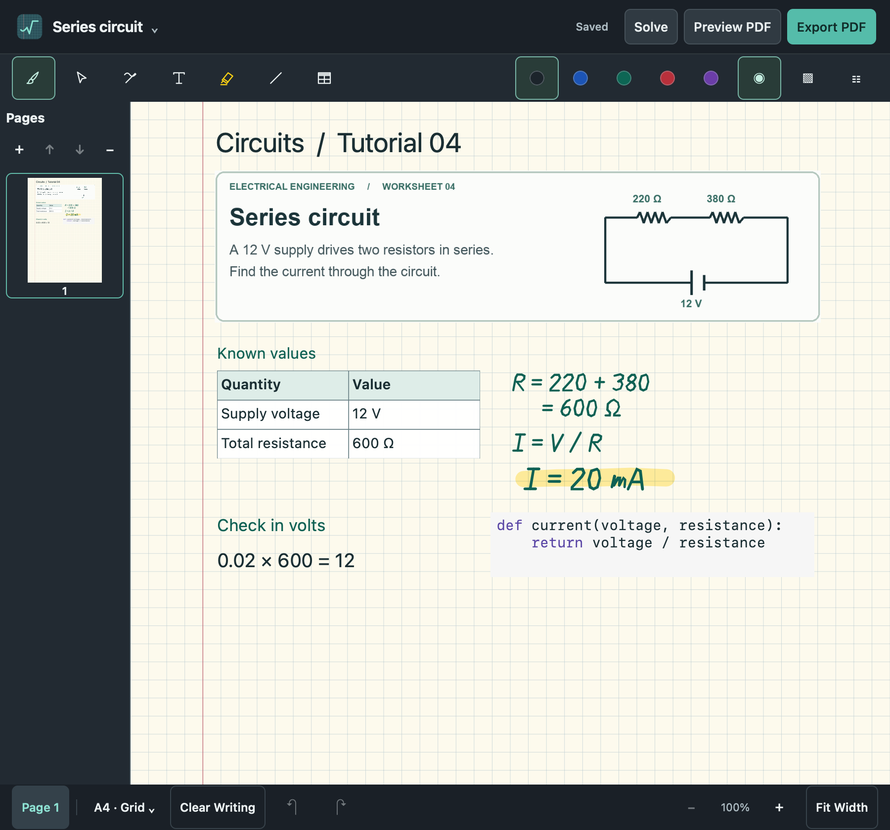

Paste an exercise, work through it with a pen, and share the finished pages as an A4 PDF. Gridnote saves your editable notebook locally and brings you back to the same page and zoom.

**[Open Gridnote in your browser](https://kam1kaze00.github.io/Gridnote/)** · **[Download a desktop app](https://github.com/Kam1kaze00/Gridnote/releases/latest)**



## Get started

| Device | How to open Gridnote |
| --- | --- |
| Mac | Download [Apple silicon](https://github.com/Kam1kaze00/Gridnote/releases/latest/download/Gridnote-macOS-arm64.zip) or [Intel](https://github.com/Kam1kaze00/Gridnote/releases/latest/download/Gridnote-macOS-x86_64.zip), extract the ZIP and open Gridnote. Requires macOS 13 or later. |
| iPad or iPhone | Open the [web app](https://kam1kaze00.github.io/Gridnote/) in Safari. Choose **Share → Add to Home Screen** to install it. |
| Android tablet or phone | Open the [web app](https://kam1kaze00.github.io/Gridnote/) in Chrome and choose **Install app** or **Add to Home screen**. |
| Windows or Linux | Get the ZIP for your processor from [Downloads](https://github.com/Kam1kaze00/Gridnote/releases/latest). Extract it and start Gridnote. Keep the launcher running while using the notebook in your browser. |

The launcher offers **Continue notebook**, **New notebook** and **Open file**. The first time you use Gridnote, choose New or open an existing notebook or PDF. On a tablet, wait for **Ready offline** before disconnecting.



## Work on a page

- **Write.** Press **Q** for Writer. Choose **Pen** for ballpoint notes, **Fineliner** for diagrams, **Fountain** for broad and fine diagonals, **Brush** for pressure-sensitive strokes or **Pencil** for graphite shading. Brush has Inked and Dry finishes. Tap Writer to set each tip’s width or adjust how it responds to your hand. Pen also has an **Ink flow** control.
- **Edit.** Press **W** to select, **E** to erase or **R** to type. Select a stroke, image, text block or table to move or resize it. Undo and redo work on edits and page operations.
- **Add the exercise.** Paste a screenshot, import an image or open a PDF. On a tablet or phone, you can photograph and crop an exercise directly into the current page.
- **Work it out.** Add a highlighter mark, table, code block or shape. Drag **Shapes → X–Y axes** to lay out a graph. Use **Solve** to review a supported equation or code snippet. You can correct what the app reads before using the result.
- **Organize and share.** Choose grid, ruled, dotted or plain paper. Open **Pages** to add or move sheets. **Clear Writing** removes Writer strokes on the current page. **Preview PDF**, **Export PDF** and the system share sheet use the same A4 page breaks.



[Open the editable Writer samples](docs/examples/Writer%20samples.gridnote).

On a two-button Wacom pen, tap the upper switch, erase, then lift to return to Writer. Hold the lower switch and move vertically to scroll.



Try the circuit worksheet in the screenshot as an [editable notebook](docs/examples/Series%20circuit.gridnote) or [PDF](docs/examples/Series%20circuit.pdf).

## Files and privacy

Save an editable **.gridnote** copy to move work between devices or back it up before clearing browser storage. PDF export creates a separate document. Image recognition runs on the device. On the Mac, Windows and Linux desktop apps, **Solve → Ask AI** opens ChatGPT sign-in on first use. Approve Gridnote and the answer appears in the same popup. Later clicks use that connection. Eligible requests use your ChatGPT plan or credits. Gridnote sends the exercise text and its preview crop when you ask. Open **Account** in the popup to manage usage or disconnect. **Copy** puts the exercise on your clipboard on every platform. The hosted iPad and Android web app offers offline Solve and Copy. [ChatGPT plan usage](https://help.openai.com/en/articles/20001542-using-your-chatgpt-plan-in-other-apps-and-sites)

## Build from source

On a Mac with Command Line Tools and Go 1.26 or later installed, run `./build.sh` and open `build/Gridnote.app`. The downloadable Mac app is ad hoc signed. If macOS blocks the first launch, follow the instructions included in the ZIP. [Apple’s guidance](https://support.apple.com/en-us/102445)

To run the portable editor locally, use Python 3 from the repository root.

```sh
python3 scripts/prepare_web.py build/standalone
python3 study_server.py --site build/standalone
```

Open [the local notebook](http://127.0.0.1:8765). For the optional Python study server, set `OPENAI_API_KEY` in the server environment. To build a Windows or Linux launcher, use `scripts/desktop.py` with Go installed. Release packaging and verification are described in the [implementation notes](docs/implementation.md).

[User guide](https://kam1kaze00.github.io/Gridnote/guide.html) · [Report an issue](https://github.com/Kam1kaze00/Gridnote/issues) · [MIT license](LICENSE)
