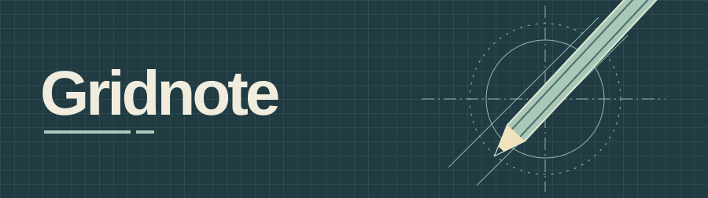
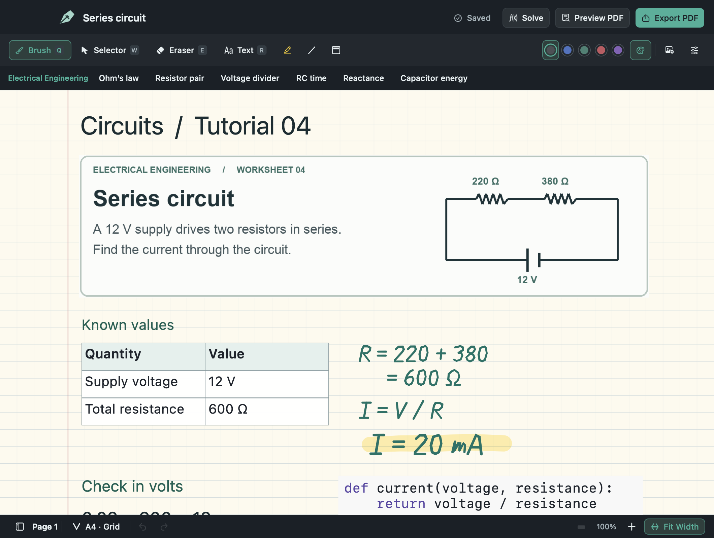
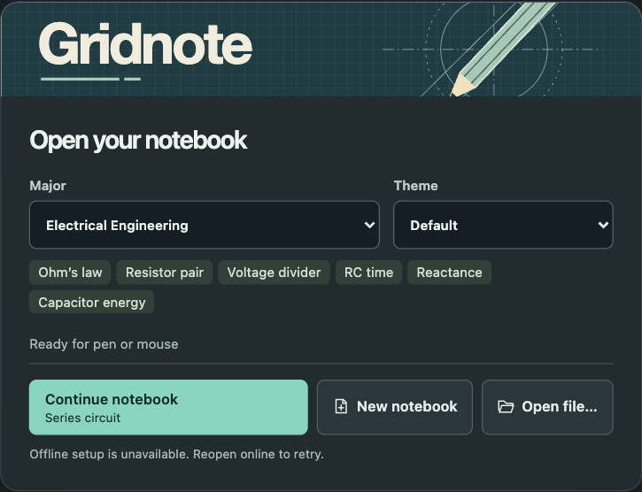
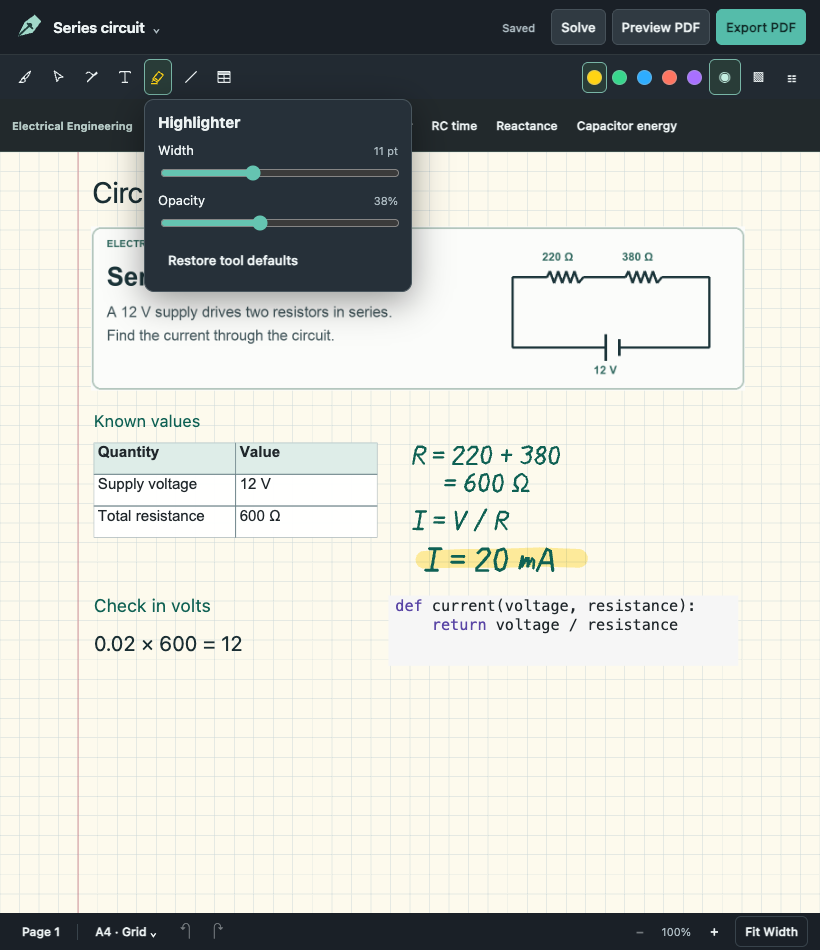
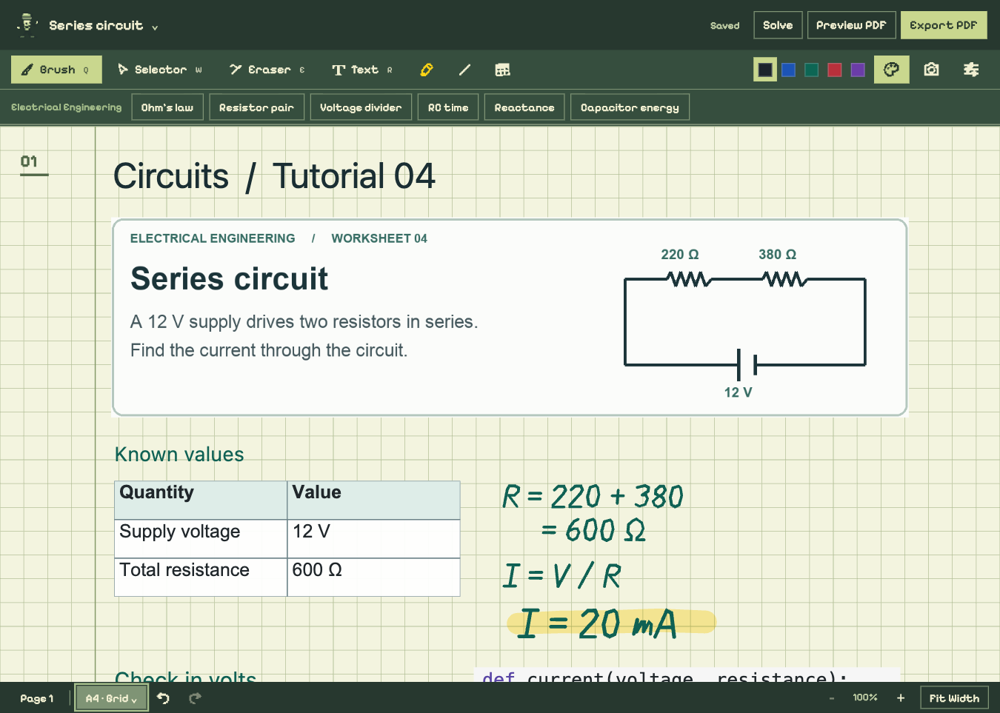

# Gridnote

Paste an exercise, solve it by hand, and share the finished A4 pages. Gridnote saves locally and reopens at the same place.

[Open the notebook](https://kam1kaze00.github.io/Gridnote/) · [Download Gridnote](https://github.com/Kam1kaze00/Gridnote/releases/latest) · [Ask a question](https://github.com/Kam1kaze00/Gridnote/discussions/categories/q-a) · [Suggest an idea](https://github.com/Kam1kaze00/Gridnote/discussions/categories/ideas)



## Get started

| Device | First launch |
| --- | --- |
| Mac with a pen tablet | Choose [Apple silicon](https://github.com/Kam1kaze00/Gridnote/releases/latest/download/Gridnote-macOS-arm64.zip) or [Intel](https://github.com/Kam1kaze00/Gridnote/releases/latest/download/Gridnote-macOS-x86_64.zip) for macOS 13 or later. Extract the ZIP and open Gridnote. About This Mac shows your chip. |
| Windows | Download [x64](https://github.com/Kam1kaze00/Gridnote/releases/latest/download/Gridnote-windows-amd64.zip) or [ARM64](https://github.com/Kam1kaze00/Gridnote/releases/latest/download/Gridnote-windows-arm64.zip). Extract the ZIP and run `Gridnote.exe`. |
| Linux | Download [x86-64](https://github.com/Kam1kaze00/Gridnote/releases/latest/download/Gridnote-linux-amd64.zip) or [ARM64](https://github.com/Kam1kaze00/Gridnote/releases/latest/download/Gridnote-linux-arm64.zip). Extract the ZIP and run `./Gridnote` in that folder. If your extractor drops execute permission, run `chmod +x Gridnote` first. |
| iPad or iPhone | Open the browser app in Safari. Choose **Share → Add to Home Screen**, enable **Open as Web App** if shown, then open the new icon while online. |
| Android or Chromebook | Open the browser app in Chrome and choose the browser’s **Install** action. |

On the web, **Ready offline** appears on the launcher and in the notebook menu after setup finishes. Open the same browser profile or Home Screen icon when you return. The Windows and Linux launchers open the editor in your default browser. Keep the launcher running during use.

Desktop downloads are community builds. The Mac app has an ad hoc signature and has not been notarized by Apple. The Windows executable is unsigned. Gatekeeper or SmartScreen may restrict first launch. The browser app is available on managed devices where downloads are restricted. [Apple distribution guidance](https://developer.apple.com/documentation/security/notarizing-macos-software-before-distribution) · [Microsoft SmartScreen guidance](https://learn.microsoft.com/en-us/windows/apps/package-and-deploy/smartscreen-reputation)

**If your Mac blocks Gridnote:** Extract the ZIP and try opening Gridnote once. For an unidentified-developer warning, open **System Settings → Privacy & Security → Open Anyway** for Gridnote, then confirm. Both Mac ZIPs contain these steps and a Terminal checksum command. [Apple’s instructions](https://support.apple.com/en-us/102445)

Gridnote opens to a launcher. Pick a **Major** and preview its six tools, or leave **None** for a regular notebook. **Continue notebook** restores your last notebook, scroll position and zoom. **New notebook** starts a blank page. **Open file** opens a notebook or a PDF. You can switch majors later through **File → Notebook Launcher** on Mac or **Notebook menu → Notebook launcher** on the web.



Download the [editable circuit exercise](https://raw.githubusercontent.com/Kam1kaze00/Gridnote/main/docs/examples/Series%20circuit.gridnote) or view its [finished PDF](docs/examples/Series%20circuit.pdf).

## In a lecture

- Write with **Q**, select with **W**, erase with **E**, and type with **R**. Tap a tool for options. Its icon shows the selected tip, selection shape, eraser mode, text mode, shape or table style. Brush includes Pen, Brush and Fineliner, smoothing and optional pressure response.
- On a two-button pen, tap the upper switch, erase, then lift to return to Brush. Hold the lower switch and move vertically to scroll.
- Paste a screenshot or use **Add image**. Touch devices can capture and crop a rear-camera photo. Pasted images keep their source size. Use **Selection → Fit Image to Page** when you want a smaller copy on paper. Drag a corner to see the size in millimetres and guides for matching an adjacent object’s width or height.
- Tap the page control for thumbnails. Insert, move or delete pages with their PDF backgrounds and annotations. **Remove Typed Text** can clean one page or all pages and preserves filled tables and other objects.
- Choose **Solve**, then tap a highlighted problem. Review the recognized text beside the scan. Arithmetic, real linear and quadratic equations, common unit conversions and simple code fragments work offline. Open-ended questions can use the optional tutor.
- **Preview PDF → Share** opens the system share sheet on supported devices. **Export PDF** saves the same A4 document.



## Appearance

Choose a theme in the launcher or open **Options → Theme** while writing. The launcher, pencil mark, type, tool icons, panels, and new-notebook paper change together. In an existing notebook, **Paper → Stationery** sets the look for one page or the notebook default. Your saved stationery prints in the PDF.

[Explore the five themes in the interactive gallery](https://kam1kaze00.github.io/Gridnote/gallery/). Switch between **Notebook** and **Launcher** to see the same theme in both places.

| Theme | What it looks like |
| --- | --- |
| [Default](https://kam1kaze00.github.io/Gridnote/gallery/#default) | Drafting Room. A graphite drafting board and a pale green pen nib. |
| [70s Cartoon](https://kam1kaze00.github.io/Gridnote/gallery/#cartoon) | A grinning pencil, inked tools and a double margin on ivory paper. |
| [Tokyo Neon](https://kam1kaze00.github.io/Gridnote/gallery/#tokyo) | Transit lettering, turquoise route lines and numbered station circles. |
| [Cyberpunk](https://kam1kaze00.github.io/Gridnote/gallery/#cyber) | Amber keys, graphite panels and monospaced instrument lettering. |
| [Pixelated](https://kam1kaze00.github.io/Gridnote/gallery/#pixel) | A pocket-console pencil, square-built tools and four shades of green. |



## Major tools

Choose a tool in the row below the writing toolbar. Adjust its inputs and use **Insert** to put the result on the page. The full set works offline.

| Major | Tools |
| --- | --- |
| Chemistry | Periodic table, molar mass, molarity, dilution, mass to moles, ideal gas |
| Physics | Kinematics, net force, kinetic energy, momentum, gravity, waves |
| Mathematics | Equations, right triangles, two-variable linear systems, dot product, statistics, circles |
| Electrical Engineering | Ohm’s law, resistors, voltage divider, RC time constant, reactance, capacitor energy |
| Mechanical Engineering | Axial stress, strain, torque, shaft power, springs, thermal expansion |
| Computer Science | Number bases, two’s complement, bitwise operations, data sizes, truth tables, binary search |
| Medicine | Microscopy, anatomical planes, direction terms, tissue types, heart blood flow, cell cycle |

## Storage and optional AI

The Mac app writes editable notebooks and recovery copies locally. The portable app saves in the current browser’s local library. Download a `.gridnote` file from the notebook menu to back it up or move it to another device.

Image recognition runs on the device. **Ask AI** sends the selected exercise text and displayed crop to a configured local study server. The server uses the OpenAI Responses API with your key and API billing. A static hosted build supports the **Copy to ChatGPT** handoff.

## Build

On macOS with the Command Line Tools, run `./build.sh` and open `build/Gridnote.app`. The build targets macOS 13 or newer and uses an ad hoc signature.

For the offline portable app, run the following from the source directory.

```sh
python3 scripts/prepare_web.py build/standalone
python3 study_server.py
```

Open [the local notebook](http://127.0.0.1:8765). Set `OPENAI_API_KEY` in the server environment to enable Ask AI. To host the installable app, serve `build/standalone` over HTTPS. To build a Windows or Linux executable with Go, use `python3 scripts/desktop.py build/standalone build/releases --os windows --arch amd64`. The launcher serves embedded assets on loopback.

To package a release from a committed revision on a Mac with Go and the Command Line Tools, run `python3 scripts/release.py build/releases --ref HEAD`. The command assembles eight ZIPs and their SHA-256 checksums from that revision in a clean directory.

For a problem report, include your OS, device, Gridnote version and the steps that trigger it. [Report an issue](https://github.com/Kam1kaze00/Gridnote/issues)

The project includes an [online user guide](https://kam1kaze00.github.io/Gridnote/guide.html), [design sources and verification notes](docs/implementation.md), and an [MIT license](LICENSE). Bundled dependencies retain their own licenses.
